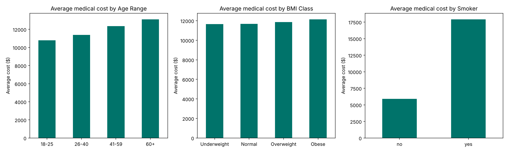

# Medical Cost Analysis

An analysis of **10,000 US patient records** to find what drives medical costs, using **Excel, MySQL, Power BI and Python**.

**Business question:** Which patient groups drive the most medical cost, and where should a health programme or insurer focus first?



---

## Key findings

1. **Smoking is the biggest cost driver by far.** Smokers cost an average of **$17,922** per patient, about **3 times** the **$5,895** for non-smokers. Smokers are half the patients but **75% of total cost**.
2. **Cost rises steadily with age.** Average cost goes from **$10,787** (ages 18 to 25) to **$13,116** (60+). Adults aged **41 to 59** make up **42.5%** of total cost, mainly because they are the largest group.
3. **Obese patients carry the largest share of BMI-related cost.** They account for **40%** of total cost. Their average cost is only slightly higher than other BMI classes, so most of the share comes from group size.
4. **Region and gender make almost no difference.** All four regions sit within 2% of each other on average cost, and men and women cost about the same.

## Recommendations

- **Make smoking cessation the first priority.** It is the one factor that multiplies cost, not just adds to it.
- **Target prevention at adults aged 26 to 59**, who carry over 70% of total cost.
- **Pair weight-management support with smoking programmes**, rather than running separate region-based campaigns, since region has little effect.

---

## Data

| Column | Description |
|---|---|
| Age | Patient age (18 to 65) |
| Sex | male / female |
| BMI | Body mass index (15 to 40) |
| Children | Number of dependants (0 to 5) |
| Smoker | yes / no |
| Region | northeast, northwest, southeast, southwest |
| Medical Cost | Annual medical cost in US dollars |

**Data quality checks:** no missing values, no duplicate rows, and all values within sensible ranges.

## Approach

| Step | Tool | What was done |
|---|---|---|
| 1. Clean and group | Excel | Checked the data, added age ranges and BMI classes, built pivot tables and charts |
| 2. Query | MySQL | Average and total cost by smoking status, age group, BMI category and region, using `GROUP BY` and `CASE` |
| 3. Visualise | Power BI | Dashboard with KPI cards, cost trends by age and BMI, and slicers for age range and smoker |
| 4. Check and automate | Python (pandas, matplotlib) | Jupyter notebook with data checks, standard WHO BMI classes, summary tables and charts |

## Files

| File | What it is |
|---|---|
| `initial data.csv` | Raw data, 10,000 rows |
| `Final Report.xlsx` | Cleaned data, pivot tables and charts (Excel) |
| `hospitaldataproject 1.sql`, `hospitaldataproject 2.sql` | MySQL queries |
| `MC data vis.pbix` | Power BI dashboard |
| `medical_cost_analysis.ipynb` | Jupyter notebook: data checks, summaries and charts |
| `Medical Data Report.docx` | Written report of findings |

## How to run the notebook

Open `medical_cost_analysis.ipynb` on GitHub to see the results without running anything. To run it yourself:

```bash
pip install pandas matplotlib jupyter
jupyter notebook medical_cost_analysis.ipynb
```

It shows the data checks and summary tables, and saves `average_cost_charts.png` and `cleaned_medical_data.csv`.

## What I would improve

- **BMI classes:** the first SQL version grouped BMI 25 to 40 as one class, which mixed overweight and obese patients. The Python notebook uses the standard WHO classes (under 18.5, 18.5 to 24.9, 25 to 29.9, 30 and over).
- **Totals vs averages:** some groups have high total cost simply because they have more patients. Comparing average cost per patient gives a fairer picture, which is how the smoking effect became clear.

---

**Author:** Chigozie Uba · Tools: Excel, MySQL, Power BI, Python
